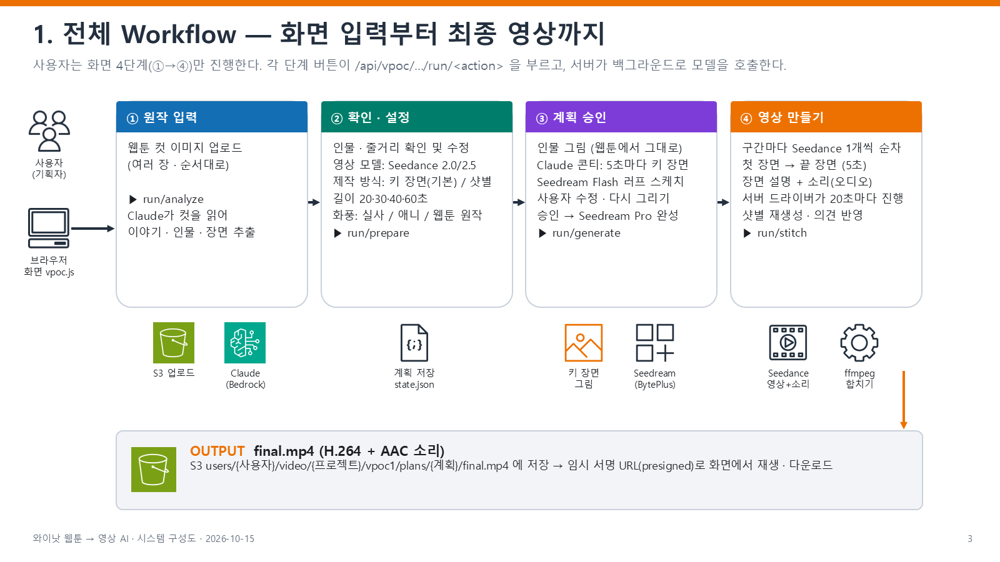
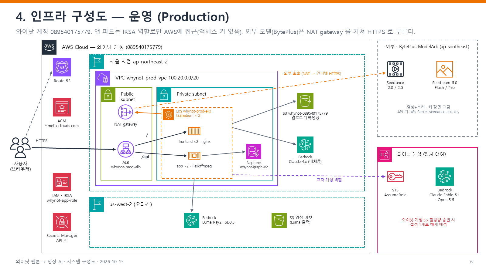

# video-vibecode — 와이낫 웹툰 → 영상 AI

웹툰 컷 이미지를 올리면 이야기 · 인물을 분석하고, 키 장면(콘티)을 그린 뒤 소리가 들어간 영상(final.mp4)까지 만드는 시스템의 코드와 구성 문서.

기준: 2026-10-19 · 운영 배포본과 같은 커밋(`fceb363`, 이미지 `ci-fceb3634`).

## 폴더

| 경로 | 내용 |
|---|---|
| [`docs/와이낫_시스템구성도.pptx`](docs/와이낫_시스템구성도.pptx) | 시스템 구성도 PPT 13장 (Workflow · 인프라 · 배포 · 모델 · 코드 트리) — AWS 공식 아이콘 사용 |
| [`docs/slides/`](docs/slides/) | PPT 각 장 미리보기 이미지 |
| [`AI-POC-whynot/`](AI-POC-whynot/) | 실제 코드 (백엔드 · 화면 · 쿠버네티스 · 배포 · IaC) |
| [`AI-POC-whynot/CODE_TREE.md`](AI-POC-whynot/CODE_TREE.md) | 전체 파일 트리와 각 파일 설명, 화면 단계별 코드 표 |

## 전체 흐름

| 화면 | 하는 일 | 서버 코드 | 외부 모델 |
|---|---|---|---|
| ① 원작 입력 | 웹툰 컷 업로드 → 이야기 · 인물 · 장면 추출 | `app/src/vpoc/routes.py`, `llm.py`, `images.py` | Claude (Amazon Bedrock) |
| ② 확인 · 설정 | 영상 모델(Luma · Seedance · fal.ai 등록 모델) · 영상 길이(모델이 한 번에 만들 수 있는 범위) · 화풍 | `routes.py`, `compose.py`, `fal.py` | Claude, fal 카탈로그 |
| ③ 계획 승인 | **마스터 프롬프트 1개** = 화풍 + 고정 배경(프롬프트+그림) + 고정 인물(외모 프롬프트+사진) + 시간대별 장면. 장면마다 미리보기 그림(확인용) | `routes.py`, `llm.py`, `compose.master_video_prompt`, `seedream.py` | Claude, Seedream 5.0 |
| ④ 영상 | 승인한 마스터 프롬프트 **그대로** 영상 1개 생성(인물 사진+배경 그림을 참고 이미지로, 미리보기 그림은 넣지 않음) | `ark.py`, `fal.py`, `video.py`, `regen.py`, `app/src/stitcher.py` | Seedance 2.0/2.5, fal.ai(Kling·Veo·Hailuo…), Luma Ray2 |

> 이전 방식(샷/구간별로 나눠 만든 뒤 이어붙이기)은 이미 만든 계획에서만 그대로 동작한다.

## 인프라 (운영)

- AWS 서울 리전: ALB → EKS(frontend nginx ×2, app Flask ×2) → Neptune · S3 · Bedrock
- us-west-2: Bedrock Luma Ray2 · SD3.5, 영상 출력 버킷
- 외부: BytePlus ModelArk (Seedance · Seedream) — NAT gateway 경유 HTTPS

## 이 저장소에 없는 것

- 환경별 실제 설정 파일(`deploy/config.dev.env`, `config.prod.env`), 계정 자원 스냅샷(`infra/inventory/`), 내부 작업 기록(`docs/` 원본, `CLAUDE.md`)
- 비밀값(API 키 · 비밀번호 · 토큰)은 코드에 없고 환경변수 / Kubernetes Secret 으로 주입된다.
- 코드 주석 · 기본 설정값에 AWS 계정 ID · 내부 도메인 · 버킷 이름이 남아 있으므로 **비공개(Private) 저장소로 유지**할 것.
